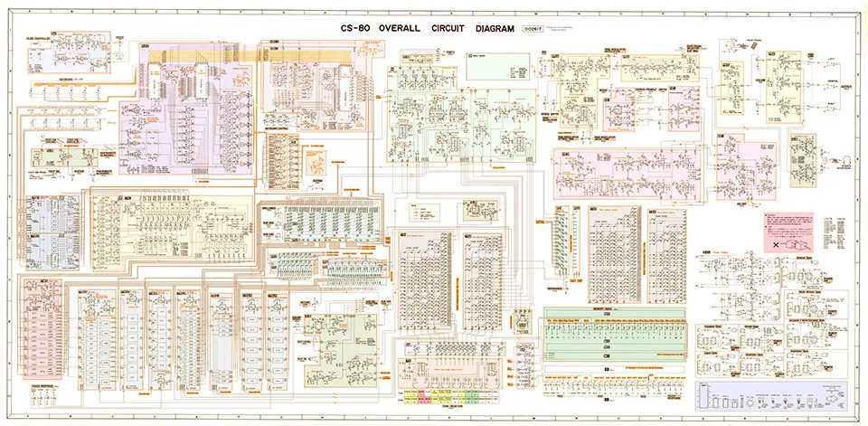

# CSXXL
CSXXL is a two-layer, polyphonic synthesizer for the Akai Force and MPC OS, in the spirit of the Yamaha CS-80. It is a completely new build, not a port. The voices and tones are written from Deckard’s Dream voice notes, and the circuits are self-built schematics, emulated in code. Ships with presets, room for up to 1500 presets. Free, not for sale.

## Rendered from real circuitry
The sound is not a sample or a guess at a sound: the voices are built in code from real circuitry. The reference is the CS-80 overall circuit diagram below, together with Deckard’s Dream voice notes and the self-built schematics.

*CS-80 overall circuit diagram, shown as reference. The diagram belongs to its owner (Yamaha) and is not covered by this project’s licence.*

## Thanks
Thanks to the Deckard’s Dream General Build Thread (Mod Wiggler) and to Krakli for the references and guidance!

## Status
Version 1.0.10, built for Force/MPC OS (ARMv7). All 12 panel pages are rendered, and the engine follows the voice spec: selectable waves incl. white noise, 2-pole HP and LP with mix, sine/sub, CS-80 envelopes, per-key aftertouch, host-tempo arpeggiator/echo/LFO sync, an 8-step arpeggiator gate pattern per line (ARP GATE page), ring modulator, bit crush, chorus, reverb, keysplit, a pitch mod bar and a touch ribbon.

Not yet tested on hardware. Tap a tile on the overview to open a page; OVERVIEW and < > in the header work. Q-Links follow the page, with two banks of 16 so every slider of a page can be reached. The 768 factory patches are written from 64 sound recipes (8 families x 8) with 12 variations each, see docs/PATCHES.md.

## Licence
Source is public and free to use under the [PolyForm Noncommercial License 1.0.0](LICENSE). Not for sale. Any third-party material referenced for the voices belongs to its authors under their own licences.

Factory presets 1-640 are converted from the five Arminator 2 banks (names in docs/ARM_PATCHES.md); 120 of their controls are matched, the rest sit at the neutral layer. Presets 641-768 are written recipes.
